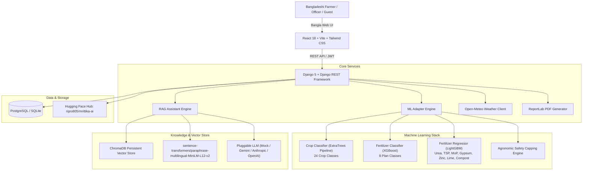

# Mrittika AI (মৃত্তিকা এআই)

> **"Right Crop, Right Fertilizer, Right Guidance - Smarter Farming with AI"**  
> *"সঠিক ফসল, সঠিক সার, সঠিক পরামর্শ — এআই দিয়ে আধুনিক চাষাবাদ"*

[](https://github.com/ripro805/mrittika-ai/actions/workflows/ci.yml)
[](https://python.org)
[](https://djangoproject.com)
[](https://react.dev)
[](https://typescriptlang.org)
[](https://huggingface.co/ripro805/mrittika-ai)

Bangla-first smart agricultural advisory web platform tailored for Bangladeshi farmers, agriculture extension officers, and agronomists. Mrittika AI combines machine learning crop recommendation, precision fertilizer guidance (supporting standard Bangladeshi farmer units like Bigha and Decimal), and a citation-grounded Bangla RAG assistant.

---

## Architecture Overview



---

## Quickstart (Run in 5 Commands)

### Option A: Local Development

```bash
# 1. Clone repository and navigate
git clone https://github.com/ripro805/mrittika-ai.git && cd mrittika-ai

# 2. Setup backend virtual environment and install dependencies
cd backend && python -m venv venv && source venv/bin/activate  # (Windows: venv\Scripts\activate)
pip install -r requirements.txt

# 3. Download & verify ML models and ingest knowledge base
python manage.py fetch_models && python manage.py migrate && python manage.py ingest_docs sample_docs

# 4. Seed demo accounts (Admin, Officer, Farmer)
python manage.py seed_demo

# 5. Start Backend and Frontend
python manage.py runserver 8000 &
cd ../frontend && npm install && npm run dev
```

Visit the app at **http://localhost:5173**!

---

### Option B: Docker Compose

```bash
# 1. Copy environment configuration
cp .env.example .env

# 2. Build and start full stack (PostgreSQL, Django Backend, Vite Frontend)
docker-compose up --build
```

Access:
- Frontend: `http://localhost` (or `http://localhost:5173`)
- Backend API & Swagger: `http://localhost:8000/api/schema/swagger-ui/`

---

## Demo Accounts

The `seed_demo` command provisions three ready-to-test accounts:

| Role | Phone | Password | Purpose |
|---|---|---|---|
| **Farmer** | `01700000003` | `Farmer@123456` | Save crop & fertilizer recommendations, download PDF reports |
| **Extension Officer** | `01700000002` | `Officer@123456` | Review flagged assistant answers, submit agronomic corrections |
| **Administrator** | `01700000001` | `Admin@123456` | Manage knowledge base documents, trigger ChromaDB re-indexing |
| **Guest** | *No login needed* | *None* | Instant crop & fertilizer advisory, interactive chat |

---

## Key Features

1. **Top-3 Crop Recommendation**:
   - Analyzes soil Nitrogen (N), Phosphorus (P), Potassium (K), pH, and weather (temperature, humidity, rainfall).
   - District selector with 1-click **Open-Meteo auto-fill** with 30-minute caching.
   - Outputs top-3 crops with confidence percentages and Bangla agronomic rationale.

2. **Precision Fertilizer Advisory**:
   - Converts standard kg/ha into farmer-friendly units: **kg/bigha** (`0.13355`) and **kg/decimal** (`0.004047`).
   - Total calculation based on user's land area.
   - Stage-by-stage application schedule (Basal, Tillering, Panicle Initiation, Flowering).
   - Dynamic soil health notes (acidity warning, organic matter booster).
   - **Safety layer**: Hard agronomic capping derived from BARC fertilizer guidelines (prevents toxic overdosing).

3. **Bangla Agricultural Assistant (RAG)**:
   - Grounded in verified documents (BARC Fertilizer Recommendation Guide, BRRI Rice Knowledge Bank, BARI).
   - System prompt refuses medical advice, off-topic prompts, and unverified pesticide dosing.
   - Always provides exact source citations `[সূত্র: নথি, পৃষ্ঠা]`.
   - Safe fallback referring to the local **Upazila Agriculture Officer (উপজেলা কৃষি অফিসার)**.
   - Speech-to-text voice input via Web Speech API (`bn-BD`).

4. **1-Page Bangla PDF Report**:
   - Direct export via ReportLab embedding **Noto Sans Bengali**.
   - Contains recommendation summary, fertilizer breakdown table, application timeline, and agricultural officer contact instructions.

---

## Environment Variables

| Variable | Default | Purpose |
|---|---|---|
| `DEBUG` | `False` | Django debug mode (must be False in production) |
| `SECRET_KEY` | - | Django cryptographical secret key |
| `ALLOWED_HOSTS` | `localhost,127.0.0.1` | Allowed Host headers |
| `DATABASE_URL` | `sqlite:///db.sqlite3` | PostgreSQL connection string in production |
| `HF_REPO_ID` | `ripro805/mrittika-ai` | Hugging Face repository containing verified model weights |
| `HF_REVISION` | `main` | Git commit/tag in Hugging Face repository |
| `HF_TOKEN` | - | Read token for Hugging Face Hub |
| `LLM_PROVIDER` | `mock` | RAG assistant provider (`mock`, `gemini`, `anthropic`, `openai_compatible`) |
| `GEMINI_API_KEY` | - | Google Gemini API Key (when LLM_PROVIDER=gemini) |
| `EMBEDDING_MODEL` | `paraphrase-multilingual-MiniLM-L12-v2` | Sentence transformer embedding model |

---

## API Documentation & Curl Examples

Interactive Swagger documentation is available at:
- **Swagger UI**: `/api/schema/swagger-ui/`
- **ReDoc**: `/api/schema/redoc/`

### 1. Crop Recommendation

```bash
curl -X POST http://localhost:8000/api/v1/crop/recommend \
  -H "Content-Type: application/json" \
  -d '{
    "nitrogen": 80,
    "phosphorus": 40,
    "potassium": 40,
    "ph": 6.5,
    "temperature": 28,
    "humidity": 75,
    "rainfall": 180,
    "season": "kharif",
    "soil_type": "clayey",
    "district": "bogura"
  }'
```

### 2. Fertilizer Recommendation

```bash
curl -X POST http://localhost:8000/api/v1/fertilizer/recommend \
  -H "Content-Type: application/json" \
  -d '{
    "crop": "rice_aman",
    "nitrogen": 80,
    "phosphorus": 40,
    "potassium": 40,
    "ph": 6.5,
    "season": "kharif",
    "soil_type": "clay_loam",
    "land_area": 1.0,
    "area_unit": "bigha"
  }'
```

### 3. RAG Chatbot

```bash
curl -X POST http://localhost:8000/api/v1/chat \
  -H "Content-Type: application/json" \
  -d '{
    "message": "আমন ধানে ইউরিয়া সার প্রয়োগের নিয়ম কী?",
    "crop_context": "rice_aman"
  }'
```

---

## License

This project is licensed under the Apache 2.0 License. The embedded font **Noto Sans Bengali** is licensed under the SIL Open Font License (OFL) 1.1.
