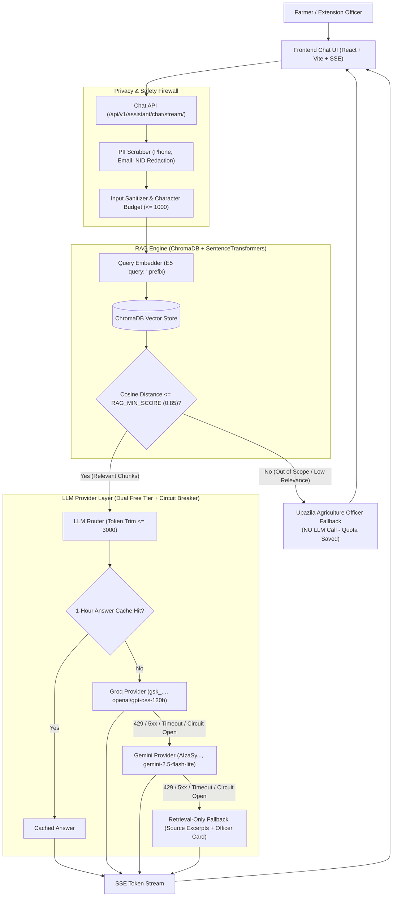
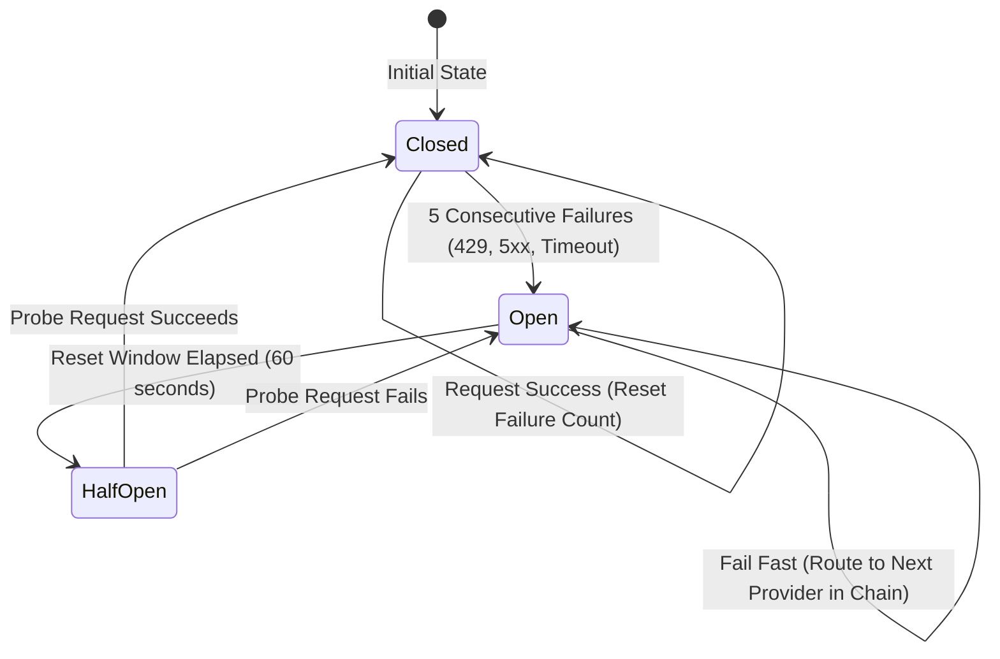

# Mrittika AI (মৃত্তিকা এআই) - Agricultural Chatbot Architecture & Implementation

Mrittika AI features a production-quality, bilingual (Bangla-first) Agricultural Advisory Chatbot built for Bangladeshi farmers and agricultural extension officers. It operates on **free-tier LLM APIs** (Groq and Google Gemini) with deterministic offline fallbacks, strict prompt-injection defenses, PII protection, and source citation grounding.

---

## 1. System Architecture



---

## 2. LLM Provider Layer & Automatic Failover

### Provider Matrix

| Provider | Model ID (Env Configurable) | Free Tier Rate Limit | Soft Limit Guard | Endpoint / SDK |
|---|---|---|---|---|
| **Groq** | `GROQ_MODEL=openai/gpt-oss-120b` | 30 RPM / 14.4k RPD / 8k TPM | 25 RPM / 13k RPD | HTTP POST `api.groq.com/openai/v1/chat/completions` (Bearer token) |
| **Gemini** | `GEMINI_MODEL=gemini-2.5-flash-lite` | 15 RPM / 1.5k RPD | 12 RPM / 1.4k RPD | Google Generative Language REST API (`v1beta`) |
| **Mock** | `mock` | Unlimited | None | Deterministic local generator for CI/CD & offline dev |
| **Retrieval-Only**| N/A | Unlimited | None | Assembles top source excerpts + Bangla officer advisory |

### Circuit Breaker & Failover State Machine



1. **Preemptive Soft Limiting**: In-memory rolling counters track requests per minute and per day. If a provider reaches its soft cap (e.g. 25 RPM for Groq), the router skips it before hitting the hard 429 limit.
2. **Circuit Breaker**: If any provider experiences 5 consecutive failures, its circuit opens for 60 seconds. Subsequent requests fail over immediately to the next provider without incurring HTTP connection delays.
3. **Graceful Retrieval Degradation**: If both Groq and Gemini are unavailable, the router constructs a retrieval-only fallback citing retrieved source chunks, ensuring the user **never receives a raw 500 error**.
4. **Secret Redaction**: API keys are scrubbed from all exception traces, logger messages, and API responses.

---

## 3. RAG Pipeline & Safety Engineering

### Multi-Format Document Ingestion
The ingestion engine (`apps.assistant.rag_engine.ingest_documents`) supports `.pdf` (via `pypdf`), `.md`, and `.txt` files:
- **Chunking**: Chunks of ~1200 characters with 200 character overlap.
- **Deduplication**: Content-hash (`hashlib.sha256`) deduplication prevents duplicate embeddings.
- **Prefix Formatting**: Prepends `passage: ` for multilingual E5 models (`intfloat/multilingual-e5-large`).
- **Metadata**: Retains source document title, page number, file hash, and sample document flag.

### Strict Safety & Injection Defenses
1. **PII Scrubbing**: Regex filters strip Bangladeshi mobile numbers (`01[3-9]\d{8}`), emails, and National ID patterns (`\b\d{10,17}\b`) before prompt assembly.
2. **Relevance Thresholding (`RAG_MIN_SCORE`)**: If cosine distance exceeds 0.85, the query is deemed out-of-domain or unanswered in verified literature. The system returns the official Upazila Officer referral **with NO LLM call**, protecting free API quotas.
3. **Pesticide Dosing Refusal**: Specific chemical pesticide dosage calculations are strictly prohibited in system prompts to prevent crop poisoning and health hazards.
4. **Context Isolation**: User input and retrieved context are delimited within `<user_question>` and `<context>` XML blocks and treated strictly as data, defeating prompt injection attempts.
5. **Token Budgeting**: Conversations are capped at the last 4 turns, retrieved context is budgeted to `MAX_PROMPT_TOKENS` (3000 tokens), and outputs are capped at `MAX_OUTPUT_TOKENS` (600 tokens).

---

## 4. Chat API Endpoints

| Endpoint | Method | Auth | Description |
|---|---|---|---|
| `/api/v1/assistant/chat/` | POST | Optional | Standard JSON request/response with source citations. |
| `/api/v1/assistant/chat/stream/` | POST | Optional | Server-Sent Events (SSE) streaming tokens in real time. |
| `/api/v1/assistant/sessions/` | GET | Authenticated | List all chat sessions belonging to the authenticated user. |
| `/api/v1/assistant/sessions/{id}/` | GET/DELETE | Authenticated | View or delete a specific session (protected against IDOR). |
| `/api/v1/assistant/feedback/` | POST | Optional | Submit helpfulness rating or flag incorrect answers. |
| `/api/v1/assistant/officer/flagged/` | GET | Officer / Admin | Audit queue of user-flagged answers for agricultural officers. |
| `/api/v1/assistant/officer/correct/` | POST | Officer / Admin | Submit authoritative corrections to flagged answers. |
| `/api/v1/assistant/admin/documents/` | GET/POST | Admin | List and upload knowledge base documents (.pdf, .md, .txt). |
| `/api/v1/assistant/admin/documents/{name}/` | DELETE | Admin | Remove a document from the active knowledge collection. |
| `/api/v1/assistant/admin/reindex/` | POST | Admin | Rebuild and re-index the ChromaDB vector database. |
| `/api/v1/assistant/health/` | GET | Public | Healthcheck reporting active providers (booleans only) and document counts. |

---

## 5. Knowledge Base Document Ingestion Guide

### Adding Real Agricultural Documents
The initial repository includes sample files labelled `[SAMPLE - NOT VERIFIED]`. To populate the assistant with verified Bangladeshi agronomic guidance:

1. Obtain official publications:
   - **BARC Fertilizer Recommendation Guide (FRG)**: Bangladesh Agricultural Research Council.
   - **BRRI Rice Knowledge Bank**: Bangladesh Rice Research Institute.
   - **BARI Krishi Projukti Hatboi**: Bangladesh Agricultural Research Institute.
   - **DAE Krishi Diary**: Department of Agricultural Extension.
2. Place the `.pdf`, `.md`, or `.txt` files in `backend/apps/assistant/knowledge_docs/`.
3. Ingest and re-index the collection:
   ```bash
   python backend/manage.py ingest_docs backend/apps/assistant/knowledge_docs/ --reindex
   ```
4. Verify retrieval benchmarks:
   ```bash
   python backend/scripts/eval_rag.py
   ```
