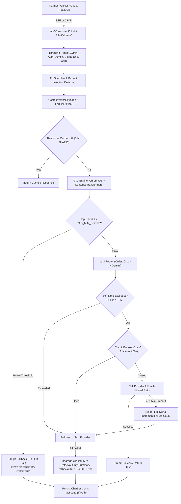

# Production-Quality Bangla Agricultural Assistant Chatbot Plan
## Mrittika AI (মৃত্তিকা এআই)

> **Document Version:** 1.0.0  
> **Status:** APPROVED & IN-PROGRESS  
> **Target Release:** Mrittika AI Assistant 2.0  

---

## 1. Executive Summary & Architectural Overview

The goal is to upgrade the existing prototype assistant into a production-grade, highly resilient, privacy-preserving, and citation-grounded **Bangla Agricultural Assistant Chatbot**. The assistant must operate reliably on **FREE-tier LLM APIs** (Groq and Google Gemini) with deterministic offline fallbacks (Mock and Retrieval-only mode), zero runtime 500 errors, robust prompt-injection defense, PII redaction, token budgeting, session management, and a token-by-token streaming React interface.

---

## 2. Technical Requirements & Component Architecture

### 2.1 LLM Provider Layer (`backend/apps/assistant/llm/`)

* **Provider Interface (`base.py`)**:
  - `BaseLLMProvider.generate(messages: List[Dict], stream: bool = False) -> Union[str, Generator[str, None, None]]`
  - Normalized response format, standard token generator protocol.
* **Groq Provider (`groq.py`)**:
  - Direct HTTP client to `https://api.groq.com/openai/v1/chat/completions` using Bearer authentication.
  - Streaming SSE generator parsing chunk `delta.content`.
  - Non-streaming parsing choice.
  - Status code handling: 429 (extract `Retry-After`), 5xx, timeouts (default 10s).
* **Gemini Provider (`gemini.py`)**:
  - Google Generative Language REST API (`v1beta/models/{model}:generateContent` and `:streamGenerateContent?alt=sse`).
  - Native JSON payload with `contents: [{role: "user", parts: [{text: ...}]}]` and `systemInstruction`.
  - Parses streaming SSE tokens and standard responses.
* **Mock Provider (`mock.py`)**:
  - Deterministic synthesis from retrieved context chunks and rule-based safety refusals.
  - Generates token stream or full string for tests and air-gapped deployments.
* **Resilient Router (`router.py`)**:
  - Configurable priority via `LLM_PROVIDER_ORDER` (default: `"groq,gemini"`).
  - **Failover Logic**: Sequentially tries providers. Automatically catches `RateLimitError`, `ProviderAPIError`, `TimeoutError`, and `MalformedOutputError`.
  - **Circuit Breaker**: 5 consecutive failures trips circuit breaker for 60 seconds (`open` state). Trips immediately skip to next candidate.
  - **Jittered Retry**: Single retry with backoff ($t = 0.5s + \text{jitter}$) before marking provider failed.
  - **In-process Soft Quota Protection**: Thread-safe in-memory sliding counters for RPM (`GROQ_RPM_SOFT`, `GEMINI_RPM_SOFT`) and daily RPD (`GROQ_RPD_SOFT`, `GEMINI_RPD_SOFT`). If threshold reached, router skips to the next provider before encountering hard 429 errors.
  - **Answer Caching**: Hashes normalized `(query_text + context_json)` and caches LLM response for 1 hour in Django cache.
  - **Graceful Retrieval-Only Degradation**: If all configured LLM providers fail or are exhausted, the router synthesizes top retrieved source excerpts with the official Bangla agricultural fallback text and sets `fallback=True`, ensuring **never a 500 error** for the user.
* **Strict Model Env Sourcing**:
  - Model identifiers come **strictly** from environment variables: `GROQ_MODEL` (default: `openai/gpt-oss-120b` or `llama-3.3-70b-versatile`) and `GEMINI_MODEL` (default: `gemini-2.5-flash-lite`).
* **CLI Diagnostic Tool (`check_llm.py`)**:
  - `python manage.py check_llm`: Verifies presence of keys, queries model list endpoints from Groq and Gemini, checks if configured models exist, and performs a 1-token live ping test.

---

### 2.2 Token Budgeting & Privacy Engineering

* **Prompt Budgeting**:
  - Groq free tier limit is ~8,000 tokens/minute.
  - Retrieval capped at $k=4$ chunks ($\approx 300\text{--}400$ tokens each).
  - Conversation memory capped at the last 4 turns.
  - Configurable `MAX_PROMPT_TOKENS` (default: 3,000) and `MAX_OUTPUT_TOKENS` (default: 600).
  - Context trimmer trims oldest history and lower-ranked chunks if budget is approached.
* **PII Redaction**:
  - Regular expressions scrub phone numbers (`01[3-9]\d{8}`), emails, and national ID patterns from prompt inputs.
  - User names, phone numbers, and location coordinates are **never** included in LLM prompts (protecting free-tier data).
* **Prompt Injection Defense**:
  - System instructions instruct LLM to treat `<context>` and `<user_question>` strictly as data, never instructions.
  - Pre-filter catches jailbreaks (`"ignore previous instructions"`, `"system prompt"`, `"পাসওয়ার্ড"`, etc.).
  - Pesticide safety filter refuses specific toxic chemical dose calculations and redirects to the Upazila Agriculture Officer.

---

### 2.3 RAG Pipeline & Ingestion (`backend/apps/assistant/rag_engine.py`)

* **Embedding Model**:
  - Configurable via `EMBEDDING_MODEL` (default: `intfloat/multilingual-e5-large`, with fallback / lightweight `sentence-transformers/paraphrase-multilingual-MiniLM-L12-v2` and `kazalbrur/bangla-embed-e5-small`).
  - Enforces `query: ` and `passage: ` prefix convention for E5 models.
  - Lazy loading with persistent in-memory caching.
* **Multi-Format Ingestion (`ingest_docs.py`)**:
  - Ingests `.md`, `.txt`, and `.pdf` (using `pypdf`/`pdfplumber`).
  - Document deduplication via SHA-256 content hashing.
  - Structured metadata: `source`, `filename`, `page`, `chunk_index`, and `is_sample` flag.
  - Idempotent re-indexing without duplicate vectors.
* **Relevance Distance Filtering**:
  - Computes cosine distance; if distance exceeds threshold (`RAG_MIN_SCORE`), triggers immediate fallback:  
    *"আমি নিশ্চিত নই। আপনার উপজেলা কৃষি কর্মকর্তার সাথে কথা বলুন।"*  
    No LLM call is made, preserving quota.

---

### 2.4 API Layer (`/api/v1/assistant/`)

* `POST /api/v1/assistant/chat`: JSON endpoint for complete question/answering.
* `POST /api/v1/assistant/chat/stream/`: Server-Sent Events (SSE) streaming tokens in real time:
  - `event: token\ndata: {"text": "..."}`
  - `event: sources\ndata: [{"source": "...", "page": "...", "snippet": "...", "is_sample": true}]`
  - `event: done\ndata: {"fallback": false, "session_id": "...", "provider": "..."}`
  - `event: error\ndata: {"error": "..."}`
* Backward compatibility: `/api/v1/chat` maintained to prevent regression in existing tests.
* **Session Persistence**:
  - Models: `AssistantSession` and `AssistantMessage`.
  - Authenticated users (Farmer/Officer/Admin) have history persisted to SQLite/Postgres.
  - Guests operate statelessly / in-memory.
  - `GET /api/v1/assistant/sessions/`: List user's sessions.
  - `DELETE /api/v1/assistant/sessions/<id>/`: Delete user's session with IDOR prevention.
* **Feedback & Corrections**:
  - `POST /api/v1/assistant/feedback/`: Rate 1-5, thumbs up/down, flag response.
  - `GET /api/v1/assistant/officer/flagged/`: Officer review queue.
  - `POST /api/v1/assistant/officer/correct/`: Officer agronomic correction.
* **Knowledge Document Admin**:
  - `GET /api/v1/assistant/admin/documents/`: List documents and chunk count.
  - `POST /api/v1/assistant/admin/documents/`: Upload and index (.pdf, .md, .txt, max 10MB).
  - `DELETE /api/v1/assistant/admin/documents/<id>/`: Remove document and vectors.
  - `POST /api/v1/assistant/admin/reindex/`: Trigger full re-indexing.
* **Health & Diagnostics**:
  - `GET /api/v1/assistant/health/`: Exposes booleans (`groq_configured`, `gemini_configured`, `embedding_ready`, `vector_store_ready`, `document_count`), never secrets.

---

### 2.5 Frontend Chat Interface (`frontend/src/pages/AssistantChatPage.tsx`)

* **Token-by-Token Streaming**:
  - `fetch` + `ReadableStream` reader with `AbortController` and visual **Stop** button.
* **Bangla Typography & Styling**:
  - Rendered with `Noto Sans Bengali`, 1000-character counter, keyboard shortcuts (Enter to send, Shift+Enter for newline).
* **Sources & Transparency**:
  - Expandable source badges under each answer.
  - Prominent **"SAMPLE - NOT VERIFIED"** badge on sample document citations.
* **Specialized UI Cards**:
  - Distinct styling for fallback answers with an actionable *"উপজেলা কৃষি কর্মকর্তার সাথে যোগাযোগ করুন"* contact card.
  - Context pill showing active crop/fertilizer plan context (dismissible).
* **Starter Prompts & Session Drawer**:
  - 6 standard Bangla agricultural starter questions.
  - Session sidebar allowing creation, switching, and deletion of conversation threads.
* **Feedback Dialog**:
  - Thumbs up/down with detailed "ভুল উত্তর রিপোর্ট করুন" modal.
* **Voice Input**:
  - Integrated `VoiceInputButton` with Web Speech API (`bn-BD`), auto-hidden if unsupported.
* **Admin Knowledge Management Tab**:
  - Administrative interface for document uploading and indexing status.
* **Accessibility & Sanitization**:
  - `aria-live="polite"` for stream output, full keyboard focus handling, DOMPurify HTML sanitization.

---

## 3. Test Strategy & Verification Matrix

| Area | Test Suite | Scope |
|---|---|---|
| **LLM Provider** | `backend/tests/test_llm_providers.py` | Unit tests with mocked HTTP (`respx` / `responses`): Groq success, Gemini success, Mock success, 429 Retry-After, 5xx server error, timeout, malformed JSON, router failover, circuit breaker open/close, soft quota counters, cache hits, model name from env, secret redaction assertion. |
| **RAG Engine** | `backend/tests/test_rag_pipeline.py` | Document ingestion idempotency, duplicate prevention, threshold fallback without LLM call, prompt injection resistance, pesticide dosage refusal, PII scrubbing, context whitelist filtering, token budget trimming. |
| **API Endpoints** | `backend/tests/test_assistant_api.py` | Throttling limits (anon vs auth), global daily cap, session CRUD, IDOR isolation, feedback submission, officer corrections, SSE streaming protocol format, health check. |
| **Regression** | `backend/tests/test_api_endpoints.py` | Ensure existing endpoints (`/api/v1/chat`, crop, fertilizer, weather, auth) continue to pass 100%. |
| **Frontend Unit** | `frontend/src/__tests__/chat_streaming.test.tsx` | Vitest + React Testing Library: SSE stream rendering, AbortController stop button, error states, source chips, feedback modal, context chip dismissal. |
| **E2E Integration** | `frontend/e2e/mrittika.spec.ts` | Playwright test: Question submission, streamed answer verification, sources expansion, fallback card display, crop context prefill. |
| **RAG Evaluation** | `backend/scripts/eval_rag.py` | Runs `docs/eval_questions.jsonl` against Mock and configured providers, reporting relevance, citation rate, and fallback accuracy. |
| **Security & Audits** | CI / Pre-commit | `ruff`, `bandit`, `pip-audit`, `npm audit`, `eslint`, `tsc --noEmit`, `gitleaks`. |

---

## 4. Environment Variables Generation Strategy

* Analyze all configuration requirements across backend, frontend, docker-compose, and GitHub Actions.
* Generate clean templates:
  - `backend/.env.example`
  - `frontend/.env.example`
  - `.env.example` (root)
* Generate git-ignored local development `.env` files:
  - `backend/.env` (safe dev settings, auto-generated secure `DJANGO_SECRET_KEY`, empty `GROQ_API_KEY=""` and `GEMINI_API_KEY=""`).
  - `frontend/.env` (`VITE_API_BASE_URL=http://localhost:8000/api/v1`).
  - `.env` (root docker-compose variables).
* Implement `python manage.py check_env` management command to validate required variables, check for insecure production configurations, warn on missing LLM keys, and verify model file availability.
* Document all environment variables in `docs/ENV.md`.

---

## 5. Implementation Roadmap & Milestones

1. **Phase 1: Architecture Planning & Documentation** (Current)
   - Write `docs/CHATBOT_PLAN.md` and record initial ADRs in `docs/DECISIONS.md`.
2. **Phase 2: LLM Provider Abstraction & Router**
   - Implement `BaseLLMProvider`, `GroqProvider`, `GeminiProvider`, `MockProvider`.
   - Implement `LLMRouter` with Circuit Breaker, Jittered Retry, Soft Quotas, Caching, and Token Budgeting.
   - Implement `check_llm` management command.
3. **Phase 3: RAG Pipeline Upgrades & Ingestion**
   - Upgrade `rag_engine.py` with PII stripping, prompt-injection defense, thresholding, and PDF support.
   - Upgrade `ingest_docs.py` with SHA-256 deduplication and idempotent indexer.
4. **Phase 4: Assistant API & Session Persistence**
   - Create `AssistantSession` and `AssistantMessage` models with migrations.
   - Implement SSE streaming endpoint `/chat/stream/` and standard `/chat/`.
   - Implement session CRUD, feedback, officer correction, and health check endpoints.
   - Maintain backward-compatible `/api/v1/chat`.
5. **Phase 5: Frontend Chat Interface Upgrade**
   - Upgrade `AssistantChatPage.tsx` with SSE streaming, Stop button, session drawer, feedback dialog, source chips with sample badges, and fallback cards.
   - Implement Admin knowledge document management tab.
6. **Phase 6: Comprehensive Automated Tests**
   - Write and run backend tests (`test_llm_providers.py`, `test_rag_pipeline.py`, `test_assistant_api.py`).
   - Write and run frontend tests (`chat_streaming.test.tsx`, update E2E tests).
   - Run `eval_rag.py` evaluation benchmark.
7. **Phase 7: Static Checks & Security Auditing**
   - Run `ruff`, `bandit`, `eslint`, `tsc --noEmit`, `pip-audit`, `npm audit`, `gitleaks`.
8. **Phase 8: Project-wide ENV Generation & Documentation**
   - Generate all `.env.example` and local `.env` files.
   - Implement `python manage.py check_env`.
   - Write `docs/ENV.md`, `docs/CHATBOT.md`, update `README.md`, `SECURITY.md`, `TESTING.md`, `KNOWN_GAPS.md`, `ACKNOWLEDGEMENTS.md`.
9. **Phase 9: Final Verification Report**
   - Run full suites and produce the final verification report.
